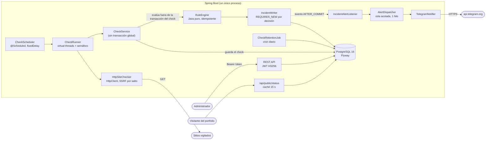

# Control Web

[](https://github.com/josemerchan712/controlweb/actions/workflows/ci.yml)

Backend que **vigila sitios web** (disponibilidad, latencia y caducidad del certificado SSL), guarda el histórico,
**abre y cierra incidencias** de forma automática, **avisa por Telegram** y ofrece una API REST privada (JWT) más un
endpoint público de estado pensado para enseñarlo en un portfolio.

> **Estado:** fase 1 (backend, probado y ejecutable en local) terminada. Quedan el dashboard en React y el despliegue
> (ver [Hoja de ruta](#hoja-de-ruta)). **Todavía no está preparado para desplegarse**: falta el rate limiting del login
> (ver [Limitaciones conocidas](#limitaciones-conocidas)).

## Qué es y por qué existe

Es un proyecto de portfolio: monitorizar webs es un problema pequeño de enunciar pero con casos reales interesantes
(falsos positivos, alertas duplicadas, seguridad de un servicio que hace peticiones a URLs que le das tú, datos que
crecen sin parar). La idea es que el código sea limpio, esté probado (más de 900 tests, escritos antes que el código) y
que cada decisión no obvia esté explicada. Mira [Decisiones de diseño](#decisiones-de-diseño).

Qué hace:

- Comprueba cada sitio con su propio intervalo (mínimo 30 s): código de respuesta, latencia y fecha de caducidad del certificado.
- Guarda cada comprobación y calcula uptime, latencia media y p95 (en SQL) para 24 h, 7 d y 30 d.
- Abre una incidencia cuando una regla se cumple (caída confirmada, latencia alta sostenida, certificado a punto de caducar) y la cierra sola cuando se recupera.
- Envía un aviso a Telegram al abrir y otro al cerrar cada incidencia, en español.
- Borra cada noche el histórico de checks con más de `RETENTION_DAYS` días (90 por defecto; las incidencias se conservan).
- Expone `GET /api/public/status`, el único endpoint sin token, con una lista blanca estricta de campos.

## Arquitectura



Paquetes por funcionalidad (con las capas dentro de cada una), raíz `dev.josemariamerchan.controlweb`:
`site/`, `monitoring/` (checker, scheduler, histórico, estadísticas), `incident/` (reglas, escritura, API), `alert/`
(formateo y envío a Telegram), `auth/`, `publicstatus/`, `retention/`, `config/` y `common/`.

## Modelo de datos

```mermaid
erDiagram
    users {
        bigint id PK
        varchar email UK
        varchar password_hash
        varchar role
        timestamptz created_at
    }
    sites {
        bigint id PK
        varchar name
        varchar url UK
        int check_interval_seconds
        boolean active
        boolean public_visible
        timestamptz last_checked_at
        timestamptz created_at
        timestamptz updated_at
    }
    checks {
        bigint id PK
        bigint site_id FK
        timestamptz checked_at
        boolean up
        int status_code
        int latency_ms
        varchar error_message
        timestamptz cert_expires_at
    }
    alert_rules {
        bigint id PK
        bigint site_id FK
        varchar type "DOWN, HIGH_LATENCY, SSL_EXPIRING"
        int threshold
        boolean enabled
    }
    incidents {
        bigint id PK
        bigint site_id FK
        varchar type "DOWN, HIGH_LATENCY, SSL_EXPIRING"
        timestamptz opened_at
        timestamptz resolved_at
        varchar details
    }
    sites ||--o{ checks : "ON DELETE CASCADE"
    sites ||--|{ alert_rules : "3 por sitio, UNIQUE(site, type)"
    sites ||--o{ incidents : "ON DELETE CASCADE"
```



`incidents` tiene un **índice único parcial** `(site_id, type) WHERE resolved_at IS NULL`; es la pieza central del
diseño (ver abajo). El esquema lo gestiona Flyway y Hibernate solo lo valida (`ddl-auto: validate`).

## Decisiones de diseño

- **Alertas sin duplicados garantizadas por la base de datos.** El índice único parcial
  `UNIQUE (site_id, type) WHERE resolved_at IS NULL` hace imposible que existan dos incidencias abiertas del mismo tipo
  para un sitio, aunque dos comprobaciones se procesen a la vez. El código no "comprueba y luego inserta": inserta y
  trata la violación del índice como "ya estaba abierta". Así no se repite el aviso ni bajo concurrencia.
  Hay un test que lo demuestra contra un PostgreSQL real (no H2).
- **Anti-flapping.** Una caída solo se confirma tras N fallos *consecutivos* (2 por defecto) y la latencia alta exige
  varias muestras seguidas por encima del umbral. Un timeout puntual no despierta a nadie. El motor de reglas es Java
  puro, sin estado y con decisiones idempotentes: evaluar dos veces lo mismo no cambia nada.
- **Protección SSRF.** La app hace peticiones a URLs que escribe el usuario, así que se rechaza cualquier host que
  resuelva (alguna de sus IPs) a loopback, red privada, link-local, multicast o direcciones IPv6 con IPv4 embebida en
  esos rangos. La comprobación se repite **antes de cada petición y en cada salto de redirección** (las redirecciones se
  siguen a mano, máximo 5). Solo se desactiva con `app.checker.allow-private-hosts=true`, que es solo para desarrollo y tests.
- **El token de Telegram nunca llega al cliente HTTP de Spring.** Lo añade únicamente un `ClientHttpRequestInterceptor`
  justo al enviar, de modo que ni los logs, ni las excepciones, ni las trazas de `RestClient` pueden contenerlo. Un
  `MessageSanitizer` enmascara además cualquier token (también codificado como `%3A`) que aparezca en un mensaje de error.
- **La evaluación ocurre fuera de la transacción del check.** `CheckService` no es transaccional: lee (transacción
  corta) → hace la petición de red (sin conexión de base de datos retenida) → guarda el check (transacción corta) → evalúa
  las reglas por separado. Un fallo al evaluar o al avisar nunca pierde el check ya guardado, y una petición lenta no
  agota el pool de conexiones.
- **Avisos desacoplados.** Las incidencias publican eventos que se consumen con `@TransactionalEventListener(AFTER_COMMIT)`;
  el envío va por una cola acotada con un solo hilo, reintentos limitados y respeto a `retry_after` de Telegram. Si
  Telegram falla, la comprobación y la incidencia siguen intactas.
- **El endpoint público es una lista blanca.** `GET /api/public/status` devuelve solo `status`, `generatedAt` y, por sitio,
  `name`, `status` y `uptime30d`. Solo se leen sitios públicos y activos (un sitio privado ni siquiera llega al código),
  hay caché de 15 s con una única carga simultánea y CORS propio con orígenes exactos.
- **Arranque seguro (fail-fast).** Sin `JWT_SECRET` válido, contraseña de administrador de 12+ caracteres, CORS sin
  comodines o con `RETENTION_DAYS` menor de 30, la aplicación no arranca y dice exactamente qué corregir, antes de tocar la base de datos.
- **Tiempo inyectable.** Todo usa un `Clock`; los tests de ventanas de tiempo (retención, uptime, intervalos) son deterministas.
- **Consultas de lectura medidas.** `/api/status` cuesta 3 sentencias SQL sea cual sea el número de sitios (test con
  contador de sentencias), y los índices usados se comprueban con `EXPLAIN` en los tests.

## Puesta en marcha en local

Requisitos: JDK 21 (con `JAVA_HOME` configurado) y Docker Desktop.

1. Copia la configuración y rellénala (nunca subas `.env`):

   ```powershell
   Copy-Item .env.example .env
   ```

   Edita `.env`: `DB_PASSWORD`, `ADMIN_PASSWORD` (12+ caracteres) y `JWT_SECRET`. Para generar este último:

   ```powershell
   $b = New-Object byte[] 32; [Security.Cryptography.RandomNumberGenerator]::Create().GetBytes($b); [Convert]::ToBase64String($b)
   ```

2. Arranca PostgreSQL 16 (limitado a 256 MB):

   ```powershell
   docker compose up -d
   ```

3. Arranca la aplicación (con el perfil `dev` se permiten sitios en `localhost` y se publica Swagger UI):

   ```powershell
   .\mvnw.cmd spring-boot:run "-Dspring-boot.run.profiles=dev"
   ```

4. Comprueba que está viva: `Invoke-RestMethod http://localhost:8080/actuator/health`.
   Documentación interactiva (solo con el perfil `dev`): <http://localhost:8080/swagger-ui.html>.

## Variables de entorno

Ningún valor real está en el repositorio; `.env.example` solo trae marcadores.

| Variable | Obligatoria | Descripción |
|---|---|---|
| `DB_URL` | no (por defecto, el PostgreSQL local) | URL JDBC |
| `DB_USERNAME` / `DB_PASSWORD` | sí (`DB_PASSWORD`) | Credenciales de la base de datos |
| `JWT_SECRET` | **sí** | Base64 de al menos 32 bytes aleatorios; sin él la app no arranca |
| `JWT_TTL_MINUTES` | no (60) | Vida del token de acceso, entre 1 y 1440 |
| `ADMIN_EMAIL` | **sí** | Email del único administrador (se crea al arrancar; no hay registro público) |
| `ADMIN_PASSWORD` | **sí** | 12+ caracteres (72 bytes como máximo) |
| `CORS_ALLOWED_ORIGINS` | no | Orígenes exactos del dashboard, separados por comas; sin `*`. Vacío = ninguno |
| `PUBLIC_CORS_ALLOWED_ORIGINS` | no | Orígenes exactos que pueden leer `/api/public/status` desde un navegador (tu portfolio) |
| `TELEGRAM_BOT_TOKEN` / `TELEGRAM_CHAT_ID` | no | **Las dos** hacen falta para enviar; si falta alguna, los avisos solo se escriben en el log |
| `RETENTION_DAYS` | no (90) | Días de histórico de checks que se conservan. Mínimo 30 |

Ajustes finos (intervalos, concurrencia, reintentos, cron de retención…) están comentados en `src/main/resources/application.yml`.

## Ejemplos de uso

PowerShell:

```powershell
# Login: guarda el token
$login = Invoke-RestMethod -Method Post -Uri http://localhost:8080/api/auth/login -ContentType application/json `
  -Body (@{ email = "admin@example.com"; password = "<tu ADMIN_PASSWORD>" } | ConvertTo-Json)
$h = @{ Authorization = "Bearer $($login.token)" }

# Crear un sitio (visible en la página pública)
$body = @{ name = "Mi blog"; url = "https://example.com"; checkIntervalSeconds = 60; publicVisible = $true } | ConvertTo-Json
Invoke-RestMethod -Method Post -Uri http://localhost:8080/api/sites -Headers $h -ContentType application/json -Body $body

# Comprobación inmediata, estado de todos, estadísticas, histórico e incidencias
Invoke-RestMethod -Method Post -Uri http://localhost:8080/api/sites/1/check -Headers $h
Invoke-RestMethod -Uri http://localhost:8080/api/status -Headers $h
Invoke-RestMethod -Uri "http://localhost:8080/api/sites/1/stats?period=7d" -Headers $h
Invoke-RestMethod -Uri "http://localhost:8080/api/sites/1/checks?size=20" -Headers $h
Invoke-RestMethod -Uri "http://localhost:8080/api/incidents?status=open" -Headers $h

# Mensaje de prueba por Telegram (máximo una llamada cada 10 s)
Invoke-RestMethod -Method Post -Uri http://localhost:8080/api/alerts/test -Headers $h

# Página pública: sin token
Invoke-RestMethod http://localhost:8080/api/public/status
```

curl (Git Bash, WSL o Linux; requiere `jq`):

```bash
TOKEN=$(curl -s -X POST http://localhost:8080/api/auth/login \
  -H 'Content-Type: application/json' \
  -d '{"email":"admin@example.com","password":"<tu ADMIN_PASSWORD>"}' | jq -r .token)

curl -s -X POST http://localhost:8080/api/sites \
  -H "Authorization: Bearer $TOKEN" -H 'Content-Type: application/json' \
  -d '{"name":"Mi blog","url":"https://example.com","checkIntervalSeconds":60,"publicVisible":true}'

curl -s http://localhost:8080/api/status -H "Authorization: Bearer $TOKEN"
curl -s "http://localhost:8080/api/sites/1/stats?period=7d" -H "Authorization: Bearer $TOKEN"
curl -s "http://localhost:8080/api/incidents?status=open" -H "Authorization: Bearer $TOKEN"
curl -s http://localhost:8080/api/public/status
```

Todos los errores son `application/problem+json` (RFC 9457) y no incluyen trazas, SQL ni secretos.

### Resumen de endpoints

| Endpoint | Descripción |
|---|---|
| `POST /api/auth/login` · `GET /api/auth/me` | Token JWT / identidad del token |
| `GET/POST /api/sites`, `GET/PUT/DELETE /api/sites/{id}` | Gestión de sitios |
| `POST /api/sites/{id}/check` | Comprobación inmediata |
| `GET /api/sites/{id}/rules`, `PUT /api/sites/{id}/rules/{type}` | Reglas de alerta (umbrales y activación) |
| `GET /api/status` | Estado de todos los sitios (UP, DEGRADED, DOWN, PENDING, PAUSED) |
| `GET /api/sites/{id}/checks` · `GET /api/sites/{id}/stats` | Histórico paginado / uptime, media y p95 |
| `GET /api/incidents`, `GET /api/incidents/{id}` | Incidencias |
| `POST /api/alerts/test` | Mensaje de prueba por Telegram |
| `GET /api/public/status` | **Sin token.** Estado público (nombre, estado y uptime de 30 días) |
| `GET /actuator/health` | Healthcheck |

## Tests

```powershell
.\mvnw.cmd verify
```

Hace falta Docker en marcha: los tests de integración arrancan un único PostgreSQL 16 con Testcontainers, compartido por
todos. Los tests son herméticos: usan credenciales aleatorias por ejecución, ignoran tu `.env` y nunca envían nada a
Telegram. En GitHub, el workflow de [CI](.github/workflows/ci.yml) ejecuta `./mvnw verify` en cada push y pull request
a `main` (Java 21 Temurin, caché de Maven, permisos de solo lectura, sin secretos, acciones fijadas por SHA), y
Dependabot actualiza Maven y las acciones cada semana.

## Limitaciones conocidas

- **Rate limiting del login pendiente (obligatorio antes de desplegar).** `POST /api/auth/login` todavía no limita
  intentos; la fase de despliegue no empieza sin esto. Por eso este repositorio no debe exponerse a Internet tal cual.
- **TOCTOU / DNS rebinding.** La protección SSRF resuelve el DNS y después el `HttpClient` vuelve a resolverlo; entre
  ambos pasos un DNS malicioso podría cambiar de respuesta. Cerrarlo del todo exige fijar la IP en la conexión; para un
  panel de un solo administrador se acepta y se documenta.
- **"Caído" significa respuesta ≥ 400 o fallo de conexión.** Un sitio que devuelve 200 con una página de error, o que
  responde 404 a propósito, se interpreta según el código HTTP; no se analiza el contenido del cuerpo.
- Un solo administrador, un solo canal (Telegram), un solo proceso (el scheduler no está pensado para varias instancias).
- Los tokens de acceso no se pueden revocar antes de caducar (no hay refresh tokens ni lista de revocación).

## Hoja de ruta

- [x] Fase 1: backend completo, probado y documentado (esta versión).
- [ ] **Rate limiting del login** (requisito previo al despliegue).
- [ ] Dockerfile y despliegue en un VPS (Caddy como proxy inverso con HTTPS).
- [ ] Dashboard en React + Vite sobre la API privada, y página de estado pública para el portfolio.
- [ ] Refresh tokens y más canales de aviso.
